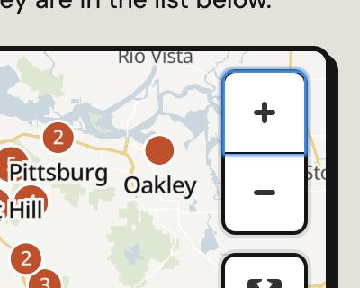
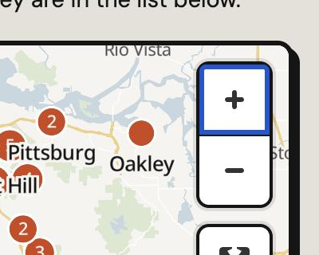

# Keyboard and screen reader check, 2026-10-26 (issue #9)

Done in a real Chromium browser on the live site, at 375 by 812 (phone) and 1024 wide (desktop). No real screen reader was run, so this does not close the VoiceOver, NVDA or TalkBack part of #9.

## What was checked

| Page | Width | Checks |
|---|---|---|
| ignition.html | 375 and 1024 | Pressed Tab 60 times from the top and logged every stop: order, focus ring (3px or more), whether it was on screen. Landmarks, heading order, controls with no name. |
| find.html | 375 and 1024 | Focused every control in turn: hidden under the sticky header, pushed off the side, controls with no name, empty headings, page scrolls sideways. |
| index.html, map.html, calendar.html, jobs.html | 375 | Same as find.html. |

## Found and fixed

- **Map zoom and full screen buttons had no site focus ring** (find.html, map.html, ignition.html). MapLibre's CSS sets `outline: none` on them and shows a 2px `#0096ff` glow instead, which is hard to see on the map. They now get the site ring (3px `--focus`), drawn inside the button so the rounded group does not cut it off. Before and after, keyboard focus on Zoom in at 375 px:

| Before | After |
|---|---|
|  |  |

## Checked and fine

- The skip link shows on the first Tab and sits over the header.
- Tab order follows the page on all pages checked. No control is hidden under the sticky header at 1024 wide (the header is not sticky at 375).
- No control without a name and no visible empty heading. The empty `h2#mPanelH` on the map pages is inside the hidden city panel, so it is not read.
- The four 1 by 1 pixel selects behind the Find pickers are `tabindex="-1"` and `aria-hidden`, so the keyboard skips them and uses the tiles.
- No page scrolls sideways at 375.

## Still to do for #9

- A pass with VoiceOver on an iPhone and NVDA on Windows.
- 200 percent zoom on desktop.
